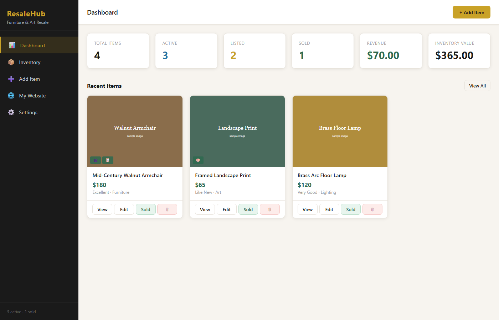
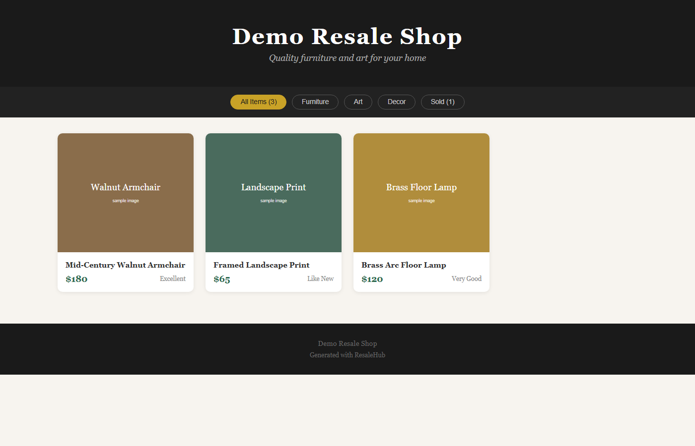

# ResaleHub

A small, self-hosted web app for managing a one-person furniture and art resale business across several online marketplaces.



## The problem

Selling second-hand furniture and art usually means posting the same item on several marketplaces at once: Facebook Marketplace, eBay, Etsy, Craigslist, OfferUp. Each site wants a different title length, description style and set of fields. Keeping track of where each item is listed, and remembering to take it down everywhere once it sells, quickly becomes a spreadsheet mess.

ResaleHub keeps one inventory record per item and produces a ready-to-paste listing for each marketplace from it, tracks where the item is listed, and records the sale.

## Features

Everything below is implemented in this repository.

- **Inventory management**: create, edit and delete items with title, description, price, original price, category (furniture, art, decor, lighting, rugs, other), condition, color, dimensions, location and tags.
- **Photo uploads**: drag-and-drop multi-photo upload (JPEG, PNG, GIF, WebP, up to 20 MB each) handled by Multer and stored on disk.
- **Per-platform listing generator**: one item becomes a formatted listing for Facebook Marketplace, eBay (HTML description, condition and category IDs, starting and Buy It Now price), Etsy (title up to 140 characters, 13 tags), Craigslist and OfferUp, each with a few selling tips. A copy-to-clipboard button is included.
- **Listing tracker**: mark an item as listed on each platform (with an optional listing URL or ID) or unlist it. Per-platform status badges show on each item.
- **Sales tracking**: mark an item as sold with the sale price and the platform it sold on.
- **Dashboard**: totals for items, active, listed and sold items, revenue from sales, and the value of the remaining inventory.
- **Search and filters**: filter the inventory by category and status, and search by text.
- **Static storefront generator**: builds a standalone `website/index.html` (with copied images) that shows the shop's items with category filters, a photo modal and an optional "Contact to Purchase" mailto link.
- **Direct posting (optional, untested against live accounts)**: code paths that call the eBay Trading API (`AddItem`) and the Etsy Open API v3 (creates a draft listing) when API credentials are entered in Settings. Without credentials these endpoints return a clear "not configured" error.
- **Responsive UI**: sidebar layout that collapses to a hamburger menu on small screens.

Not included: user accounts or authentication, a database, automatic syncing with marketplaces, or posting to Facebook, Craigslist or OfferUp (those are copy-and-paste only).

## Screenshots

| Admin dashboard | Generated storefront |
| --- | --- |
|  |  |

Screenshots use the synthetic sample data that ships with the repo.

## Architecture

```
Browser (single-page app: public/index.html + public/js/app.js, vanilla JS)
        |  fetch() JSON / multipart
        v
Express server (server.js)
  |-- REST API: /api/products, /api/products/:id/photos,
  |             /api/products/:id/listing/:platform, /listings/:platform,
  |             /sold, /api/stats, /api/settings, /api/generate-website
  |-- Multer -> public/uploads/            (photo files)
  |-- data/inventory.json, data/settings.json  (JSON file storage)
  `-- platforms/
        formatter.js  one product -> listing text per marketplace
        website.js    products -> static storefront in website/
        ebay.js       eBay Trading API client (XML over HTTPS)
        etsy.js       Etsy Open API v3 client (fetch)
```

- **Storage**: plain JSON files read and written synchronously on each request. This is simple and fine for one user with a few hundred items. It is not built for concurrent users.
- **Frontend**: no framework or build step. `app.js` keeps a small in-memory state object and re-renders each page as an HTML string.
- **Platform logic** is kept in `platforms/`, so adding a new marketplace means adding one formatter function.

## Run it locally

Requirements: Node.js 18 or later.

```bash
npm install
npm start
# open http://localhost:3000
```

On Windows you can also double-click `START.bat`, which installs dependencies if needed and opens the browser.

The port can be changed with the `PORT` environment variable (see `.env.example`). The repo ships with four synthetic sample items and placeholder images so the app has something to show on first run.

### Optional marketplace API credentials

Direct posting to eBay or Etsy needs developer credentials, entered on the **Settings** page. They are saved to `data/settings.json` in plain text, so do not commit that file once real credentials are in it.

## Tech stack

- Node.js, Express 4
- Multer (file uploads), uuid, dotenv, cors
- Vanilla JavaScript, HTML and CSS (no frontend framework, no build step)
- JSON files for storage
- eBay Trading API and Etsy Open API v3 (optional)

## How it was built

Built with [Claude Code](https://claude.com/claude-code). I described the workflow I needed as a reseller, and the app was developed with an AI coding assistant, with me directing features, testing in the browser and using it on my own listings.

## Known limitations

- No authentication. Run it on your own machine only; do not expose it to the internet.
- API credentials are stored unencrypted in `data/settings.json`.
- The eBay and Etsy direct-posting code has not been verified against live accounts. The eBay request uses US site, USD and PayPal defaults.
- The `/api/website-preview` route serves the generated HTML, but its relative image paths do not resolve from that URL. Open `website/index.html` directly to see images.
- No automated tests.
